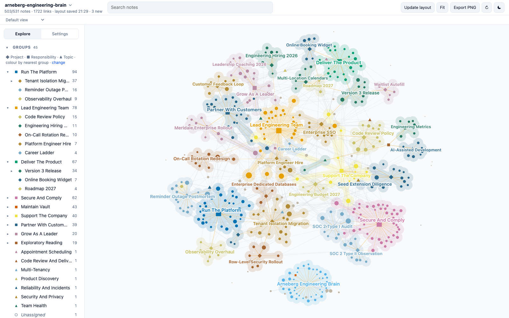

# Arneberg Engineering Brain

A demo Second Brain: about 530 linked Markdown notes holding the working memory of the fictional co-founder and engineering lead of a small software start-up. Clone it, open the folder, and explore what a vault looks like after two years of daily use: projects, decisions, incidents, meetings, people, reading, open questions, and the links between them.



**[Explore this vault in the live demo](https://mfoll.github.io/brain-graph-demo/?vault=arneberg-engineering-brain)**: its map in Brain Graph, in your browser, with nothing to install.

> [!warning]
> Everything about the company is fictional: Quaylane, every person, the customers, investors, auditor, vendors, incidents, numbers and decisions. Any resemblance to real people or organizations is accidental. Only the Sources marked as encyclopedia articles, scientific papers or documentation are real.

## What it shows

The vault was deployed from the [Second Brain template](https://github.com/mfoll/second-brain-template), which adds operating rules, workflows and a decision record to the [Portent](https://github.com/refactoringhq/portent) note model. Everything is plain files: Markdown notes with YAML frontmatter, typed relationships (`belongs_to`, `related_to`, `has`) and wikilinks. No app, database or index is required.

| Area | What to look at |
| --- | --- |
| Structure | 8 Responsibilities at the root, about 25 Projects under them, 10 Topics as lateral context; every note rolls up to a Responsibility. |
| Memory | About 180 Sources, 50 Events, 35 Questions, 30 Concepts, 15 Opinions, 14 Recaps, 40 people. |
| Real material | About 75 Sources are real public material: Wikipedia articles, open-access software engineering papers and tool documentation, cited with title, URL and identifiers and summarized in our own words. Their "Why It Matters" sections describe how the fictional company uses them. |
| Operations | `AGENTS.md`, Type notes, Procedures, Skills and ADRs from the template, unchanged except for the deployment steps. |
| History | Git history from January 2025 to October 2026, one commit for each month that had captures. |

## Open it

- **Any Markdown editor.** Clone the repository and open the folder; notes sit flat at the root by design. Start from [vault](vault.md).
- **[Tolaria](https://tolaria.md/).** Open the folder as a vault for typed sidebars, relationship panels and saved views.
- **[Brain Graph](https://github.com/mfoll/brain-graph).** See the whole vault as a map colored by project:

  ```bash
  npx github:mfoll/brain-graph path/to/second-brain-demo-startup
  ```

- **A coding agent.** Run Claude Code, Codex or Gemini CLI in the folder. They read [AGENTS](AGENTS.md) (through `CLAUDE.md` and `GEMINI.md` where needed) and follow the vault's Procedures.

## Try this

Each question has a known answer in the vault, so you can check what an agent finds.

| Ask | Where the answer lives |
| --- | --- |
| Why isn't every clinic on its own database? | A review on 2025-11-18 chose a database per tenant; a review on 2026-06-11 kept that only for enterprise contracts. See [tenant-isolation-migration](tenant-isolation-migration.md) and [architecture-review-2026-06-11](architecture-review-2026-06-11.md). |
| What caused the March reminder outage, and what did we change afterwards? | A migration batch exhausted database connections; nine actions followed. See [reminder-outage-postmortem](reminder-outage-postmortem.md) and [reminder-outage-2026-03-17](reminder-outage-2026-03-17.md). |
| How do emergency fixes get reviewed under the SOC 2 change control? | A break-glass path decided on 2026-04-08, with one engineer still disagreeing. See [engineering-meeting-2026-04-08](engineering-meeting-2026-04-08.md) and [ship-an-emergency-change](ship-an-emergency-change.md). |
| Are we hiring a platform engineer next year? | Still open. See [should-we-hire-a-platform-engineer-or-keep-everyone-on-call](should-we-hire-a-platform-engineer-or-keep-everyone-on-call.md). |
| Why did version 3 ship in September instead of June? | Release planning on 2026-06-02 moved the date. See [version-3-release](version-3-release.md) and [release-planning-2026-06-02](release-planning-2026-06-02.md). |
| What did investors ask about engineering in the seed extension diligence? | See [seed-extension-diligence](seed-extension-diligence.md) and [technical-diligence-call-2026-08-19](technical-diligence-call-2026-08-19.md). |
| What did we promise Meridale, and did we deliver? | Three contract conditions, all met. See [meridale-clinic-group](meridale-clinic-group.md) and [soc2-type-1-report](soc2-type-1-report.md). |

Workflows to try with an agent:

- **Resume a project:** "Resume the Tenant Isolation Migration."
- **Process the Inbox:** about eight raw captures from the last week of October 2026 have `_organized: false`; each has an obvious home.
- **Ingest a source:** give any article on code review, incident response or multi-tenant databases and ask where it belongs.
- **Lint the vault:** the audits should report one link to a missing note and one Concept that belongs to nothing, both left in on purpose. Informational lines, such as external contacts without a parent, are expected.

## Scope and privacy

The fictional engineering lead's work: the team and its practices, the product and its releases, customers, the platform and its incidents, security and compliance, support for the CEO's fundraising, and his leadership learning. No patient or clinical data, credentials, salaries or personal administration; company records such as the data room and audit evidence are referenced through Source notes.

## Template updates

The vault was deployed from the template on 2026-10-23. Later template improvements can be brought in with [Upgrade an Existing Vault From the Template](upgrade-existing-vault-from-template.md), as a reviewed change: an agent proposes each change, and a person approves it. Never run it unattended. A vault in use is expected to differ from the template on purpose, in its ADRs, Procedures, Skills and instructions.

## How it was made

An AI agent drafted the world specification (the company, people, projects, timeline and the storylines behind the questions above) and a person reviewed and changed it. AI agents then wrote the notes from it, one per area of the company, and retrieved the real articles, papers and documentation pages. The links, frontmatter, cross-area consistency and source metadata were checked with the template's lint scripts and against the original sources.

## Storage and backup

The notes are plain files, and their history is this Git repository. To undo edits made while trying the demo, run `git checkout .`; `git clean -n` lists any new files, which `git clean -f` would delete.

## More example vaults

This is one of nine fictional vaults deployed from the same template, each kept by a different kind of person: a lab head, a café owner, a teacher, a freelance designer, a parent running a household, a sports club chair, a novelist, a start-up engineering lead and an HR assistant. The [template README](https://github.com/mfoll/second-brain-template#example-vaults) lists them all.

## Licence

MIT, see `LICENSE`, which also covers the template material. `THIRD_PARTY_NOTICES.txt` lists upstream notices. Cited material remains under its own licence; the notes contain only its metadata and our own summaries.
